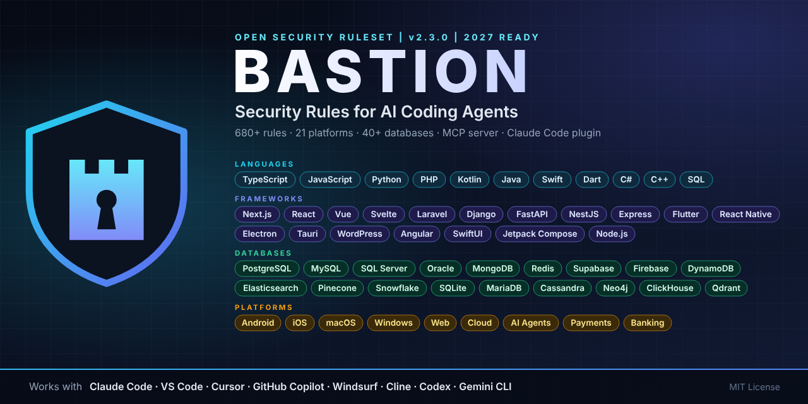

<!-- ===================== BASTION HEADER ===================== -->
<div align="center">



<br/>

[](CHANGELOG.md)
[](#-platform-coverage)
[](#-platform-coverage)
[](LICENSE)
[](CONTRIBUTING.md)

**Zero-trust security rules that make AI coding agents write, review, and ship secure code.**
<br/>
One install. Auto-detects your stack. Works in Claude Code, VS Code, Cursor, Copilot, Windsurf, Cline, Codex, and Gemini CLI.

[Quick Start](#-quick-start) · [Tools](#-supported-ai-tools) · [Platforms](#-platform-coverage) · [Commands](#-slash-commands) · [Red Lines](#-the-12-red-lines) · [Docs](docs/)

</div>

---
<!-- ========================================================== -->

## 🛡️ What is Bastion?

AI coding agents write code fast, and they repeat the same security mistakes fast: secrets in the frontend, missing authorization checks, open database tables, unverified webhooks, invented package names.

**Bastion** is a single, versioned security rulebook that every AI agent in your project follows. It gives each rule a stable ID (`AUTH-04`, `NEXT-02`, `WP-21`), so agents can cite exactly which rule a finding breaks and which rule a commit fixes.

It is built on the 2025 to 2027 standards, including banking regulations (PSD2 SCA, DORA, FAPI 2.0, SBP): OWASP Top 10 2025, ASVS 5.0, OWASP Top 10 for LLM and Agentic Applications, NIST CSF 2.0, NIST SP 800-63-4, SLSA, post-quantum cryptography (FIPS 203/204/205), PCI DSS 4.x, the EU Cyber Resilience Act, and the EU AI Act.

## ✨ What Makes It Different

| Feature | What it does |
|---|---|
| **681 rule IDs** | Every rule is citable: `[BAS-NEXT-02] Server Action without authz` |
| **12 Red Lines** | Non-negotiable rules that block a release on any platform |
| **6 operating modes** | `AUDIT`, `HARDEN`, `BUILD`, `REVIEW`, `INCIDENT`, `RELEASE` with clear do and do-not rules |
| **Stack auto-detection** | The installer reads your project and loads only the matching platform rules |
| **MCP server + Claude Code plugin** | 9 read-only tools, 10 prompts, and a plugin with 11 skills: install once, use in every repo |
| **One source, 8 tools** | Generates native rule files for each AI tool from the same rulebook |
| **Agent self-defense** | Rules that protect the agent itself from prompt injection, secret leaks, and fake packages |
| **Guard hook** | A Claude Code hook that blocks secrets in files and dangerous shell commands before they run |
| **10 slash commands** | `/bastion-secure` (analyze, check, plan, fix, adapt rules), `/bastion-site-audit`, `/bastion-audit`, `/bastion-review` and more, in Claude Code, Cursor, and Copilot |
| **Self-adapting rules** | After each audit, `/bastion-secure` writes project-specific `PRJ` rules into `.bastion/PROJECT-RULES.md` so the same bugs cannot return, and loads newly detected platforms |
| **Security scorecard** | Every audit ends with an A to F grade |
| **Definition of Done** | A release checklist the agent must pass before saying "ship it" |
| **Ready-made configs** | Next.js CSP, `.htaccess`, nginx, `wp-config`, Android network config, macOS entitlements, Supabase RLS, MongoDB, Redis, CI pipeline |
| **Banking-grade mode** | 63 fintech rules: risk tiers, transaction signing, double-entry ledger, maker-checker, SIM swap and scam protection, FAPI 2.0, DORA and SBP mapping |
| **40+ databases covered** | SQL, NoSQL, vector, serverless, warehouse, time-series, BaaS, and on-device storage |

## 🔌 Install Once, Protected Everywhere

**Claude Code plugin** (skills, guard hook, and offline MCP server in every repo):

```bash
claude plugin marketplace add bizeagencyinc/bastion
claude plugin install bastion@bastion-security
```

**MCP server** for Claude Code, Claude Desktop, Cursor, VS Code, Windsurf, Gemini CLI, and Codex:

```bash
claude mcp add --scope user bastion -- npx -y bastion-security-mcp
```

Read-only, offline, no telemetry, published with npm provenance and listed in the official MCP Registry. Details: [docs/mcp.md](docs/mcp.md) and [mcp/SECURITY-MODEL.md](mcp/SECURITY-MODEL.md).

## 🚀 Quick Start (commit rules into a repo)

**macOS, Linux, WSL, Git Bash**

```bash
git clone https://github.com/bizeagencyinc/bastion.git
./bastion/scripts/install.sh /path/to/your-project --with-ci
```

**Windows PowerShell**

```powershell
git clone https://github.com/bizeagencyinc/bastion.git
.\bastion\scripts\install.ps1 -Target C:\path\to\your-project -WithCI
```

Then open your project in your AI tool and run the full pipeline:

```text
/bastion-secure
```

It analyzes the app or website, runs the security checks, shows a fix plan for your approval, fixes what you approve, and then updates the project rules. To check a live website from the outside, run `/bastion-site-audit https://your-domain.com`.

| Option | Bash | PowerShell |
|---|---|---|
| Choose platforms | `--platforms nextjs,supabase-firebase` | `-Platforms nextjs,supabase-firebase` |
| Choose tools | `--tools claude,cursor` | `-Tools claude,cursor` |
| Add CI pipeline | `--with-ci` | `-WithCI` |
| Add MCP config to the project | `--with-mcp` | `-WithMCP` |
| List platforms | `--list` | `-List` |
| Preview only | `--dry-run` | `-DryRun` |

The installer is safe to run again: it updates its own blocks and files and never overwrites your existing settings.

## 🤖 Supported AI Tools

| Tool | What Bastion installs | How it loads |
|---|---|---|
| **Claude Code** (CLI, VS Code, JetBrains, desktop) | `CLAUDE.md` block, `.claude/commands/`, `.claude/settings.json` with deny rules and guard hook | `@` imports load the core and platform rules every session |
| **VS Code** | `.vscode/extensions.json`, `settings.json`, `tasks.json` with security scan tasks | Recommended security extensions and one-click scans |
| **GitHub Copilot** | `.github/copilot-instructions.md`, `.github/instructions/*.instructions.md`, `.github/prompts/*.prompt.md` | `applyTo` globs load platform rules for matching files |
| **Cursor** | `.cursor/rules/*.mdc`, `.cursor/commands/` | Core rule always on; platform rules attach by glob |
| **Windsurf** | `.windsurf/rules/*.md` | Lite core always on; platform rules by glob |
| **Cline / Roo Code** | `.clinerules/` | All active rules loaded |
| **OpenAI Codex and AGENTS.md tools** | `AGENTS.md` block | Points the agent at the rule files |
| **Gemini CLI** | `GEMINI.md` block | `@` imports |

Full details: [docs/integrations.md](docs/integrations.md)

## 🧭 Platform Coverage

| Platform | File | Prefix | Rules |
|---|---|---|---|
| **Core (all projects)** | [`BASTION.md`](BASTION.md) | `RED` `AGENT` `AUTH` `AUTHZ` `INPUT` `API` `DATA` `WEB` `FILE` `SEC` `CRYPTO` `SUPPLY` `INFRA` `AI` `APP` `LOG` `IR` `TEST` `PRIV` | 158 |
| Android | [`android.md`](rules/platforms/android.md) | `AND` | 29 |
| iOS / iPadOS | [`ios.md`](rules/platforms/ios.md) | `IOS` | 25 |
| macOS, Electron, Tauri | [`macos.md`](rules/platforms/macos.md) | `MAC` | 20 |
| Windows desktop | [`windows.md`](rules/platforms/windows.md) | `WIN` | 18 |
| Flutter, React Native, Expo, Capacitor | [`cross-platform-mobile.md`](rules/platforms/cross-platform-mobile.md) | `XPM` | 20 |
| Websites and SPAs | [`web-frontend.md`](rules/platforms/web-frontend.md) | `FE` | 16 |
| Next.js | [`nextjs.md`](rules/platforms/nextjs.md) | `NEXT` | 21 |
| WordPress, Elementor, WooCommerce | [`wordpress.md`](rules/platforms/wordpress.md) | `WP` | 32 |
| PHP and Laravel | [`php-laravel.md`](rules/platforms/php-laravel.md) | `PHP` | 19 |
| Node.js backends | [`nodejs.md`](rules/platforms/nodejs.md) | `NODE` | 18 |
| Python, Django, FastAPI | [`python.md`](rules/platforms/python.md) | `PY` | 18 |
| SQL databases (MySQL, MariaDB, PostgreSQL, SQL Server, Oracle, SQLite, ORMs) | [`sql-databases.md`](rules/platforms/sql-databases.md) | `SQL` | 40 |
| NoSQL (MongoDB, Redis, Valkey, Memcached, Elasticsearch, OpenSearch, DynamoDB, Cassandra, Couchbase, CouchDB, Neo4j, Cosmos DB) | [`nosql-databases.md`](rules/platforms/nosql-databases.md) | `NOSQL` | 38 |
| Vector DBs (Pinecone, Weaviate, Qdrant, Milvus, Chroma, pgvector, LanceDB) | [`vector-databases.md`](rules/platforms/vector-databases.md) | `VEC` | 12 |
| Serverless SQL, warehouses, time-series (Neon, PlanetScale, Turso, CockroachDB, BigQuery, Snowflake, Redshift, ClickHouse, InfluxDB) | [`data-platforms.md`](rules/platforms/data-platforms.md) | `DWH` | 20 |
| Local and browser storage (Room, Core Data, SwiftData, Realm, Hive, Isar, MMKV, IndexedDB) | [`local-storage.md`](rules/platforms/local-storage.md) | `LOCAL` | 20 |
| Supabase, Firebase, Appwrite, PocketBase, Convex | [`supabase-firebase.md`](rules/platforms/supabase-firebase.md) | `BAAS` | 25 |
| Cloud, CI/CD, Docker, VPS, RDP | [`cloud-devops.md`](rules/platforms/cloud-devops.md) | `OPS` | 27 |
| AI, LLM, RAG, agents, MCP | [`ai-llm-agents.md`](rules/platforms/ai-llm-agents.md) | `LLM` | 23 |
| Payments (Stripe, PayPal, wallets) | [`payments.md`](rules/platforms/payments.md) | `PAY` | 19 |
| **Banking and fintech** (banking apps, wallets, lending, trading, crypto, open banking, KYC/AML) | [`financial-banking.md`](rules/platforms/financial-banking.md) | `FIN` | 63 |
| **Total** | | | **681** |

## ⌨️ Slash Commands

Installed for Claude Code (`.claude/commands/`), Cursor (`.cursor/commands/`), and Copilot (`.github/prompts/`).

| Command | Mode | What it does |
|---|---|---|
| `/bastion-secure` | ALL | **Full pipeline:** analyze, security check (gitleaks, semgrep, audits, trivy), plan, fix with approval, adapt project rules, verify |
| `/bastion-site-audit` | AUDIT | Passive check of a live website: TLS, headers, cookies, exposed files, CMS, CORS, scripts, DMARC |
| `/bastion-audit` | AUDIT | Full audit: inventory, diagram, threat model, findings, scorecard. No code changes. |
| `/bastion-harden` | HARDEN | Fixes approved findings with small, tested, rule-cited commits |
| `/bastion-review` | REVIEW | Reviews a diff or PR and returns APPROVE or REQUEST CHANGES |
| `/bastion-threat-model` | AUDIT | STRIDE + MITRE ATLAS threat model with a Mermaid data-flow diagram |
| `/bastion-build` | BUILD | Builds a feature secure by default, with negative security tests |
| `/bastion-release` | RELEASE | Runs the Definition of Done and platform checklists, returns SHIP or BLOCK |
| `/bastion-incident` | INCIDENT | Containment, evidence, key rotation, and notification plan |
| `/bastion-fintech-audit` | AUDIT | Banking and fintech audit: money flows, ledger, fraud, device binding, regulatory mapping |

## 🚫 The 12 Red Lines

1. Secrets in code, client bundles, mobile binaries, logs, or AI prompts
2. Plaintext or reversibly encrypted passwords
3. Authorization only in the frontend, mobile UI, or middleware
4. SQL or shell commands built from untrusted strings
5. TLS verification disabled or cleartext traffic in production
6. Client-reachable tables without row-level or server-side access control
7. Webhooks processed without signature verification
8. Tests or scanners disabled to make a build pass
9. Unverified packages or `curl | bash` from untrusted sources
10. AI or user content executed as code without a sandbox
11. Production changes without explicit human approval
12. Debug mode, stack traces, admin panels, or source maps exposed in production

## 🧱 The Guard Hook (Claude Code)

`hooks/guard.sh` runs before every file write and shell command. It blocks:

- High-confidence secrets: database URLs with embedded passwords (Postgres, MySQL, MongoDB, Redis), AWS, Stripe live, GitHub, Slack, Anthropic, OpenAI, Google OAuth, SendGrid, Twilio keys, and private key blocks
- `curl | bash` style execution, recursive delete of `/` or home, force push to `main`, `DROP DATABASE`, `chmod 777`, and reading `.env` into the session

It works together with the `.claude/settings.json` deny list, which stops the agent from reading `.env`, keys, keystores, and service account files.

## 📊 Security Scorecard

| Grade | Meaning |
|---|---|
| **A** | No open Critical/High, Red Lines clear, CI gates active, tested backups |
| **B** | No open Critical, at most 2 High with a dated plan |
| **C** | No Red Line violations, but multiple High findings or missing CI gates |
| **D** | Red Line violations or open Critical findings |
| **F** | Active compromise, exposed secrets, or unauthenticated access to sensitive data |

## 📁 Repository Structure

```text
bastion/
├── BASTION.md                      Core master rules (load for every project)
├── HANDOVER.md, CLAUDE.md          Handover and maintainer guide for Claude Code
├── rules/
│   ├── BASTION-LITE.md             Compact core for tools with size limits
│   ├── manifest.txt                Platform IDs, globs, and detection signals
│   └── platforms/                  21 platform rule files
├── integrations/
│   ├── commands/                   10 slash commands (Claude Code, Cursor, Copilot)
│   ├── claude/settings.json        Deny list, ask list, guard hook
│   └── vscode/                     Extensions, settings, security scan tasks
├── hooks/guard.sh                  Secret and dangerous command blocker
├── mcp/                            MCP server (npm: bastion-security-mcp), tests, server.json
├── plugin/                         Claude Code plugin (generated by mcp/scripts/build-plugin.js)
├── .claude-plugin/marketplace.json Plugin marketplace
├── templates/
│   ├── PROJECT-RULES.md            Per-project rules, created once, updated by /bastion-secure
│   ├── threat-model.md             STRIDE + ATLAS template
│   ├── findings-report.md          Report with Red Line table and scorecard
│   ├── SECURITY.md, security.txt   Disclosure policy templates
│   ├── env.example                 Safe environment variable template
│   ├── configs/                    Next.js, nginx, .htaccess, wp-config, Android, macOS, Supabase, MongoDB, Redis, double-entry ledger
│   └── github/                     Security workflow and Dependabot
├── scripts/install.sh | install.ps1 | build-cover.py
├── docs/                           Quick start, integrations, customization
└── assets/                         Cover and logo
```

## 🛠️ Customize

- Add your own rules in a new file under `rules/platforms/` and register it in `rules/manifest.txt`. See [docs/customizing.md](docs/customizing.md).
- Keep rule IDs stable. Never reuse a retired ID.
- Re-run the installer to push changes into your projects.

## 🗺️ Roadmap

- [ ] Rule packs for Rust, Go, Java/Spring, and .NET backends
- [ ] Machine-readable `rules.json` export
- [ ] Semgrep rules mapped to Bastion IDs
- [ ] VS Code extension with an inline Red Line checker
- [ ] Translations (Urdu, Arabic)

## 🤝 Contributing

Contributions are welcome. Read [CONTRIBUTING.md](CONTRIBUTING.md) and open a pull request. Report security issues privately as described in [SECURITY.md](SECURITY.md).

## ⚠️ Disclaimer

No ruleset makes software unhackable. Bastion reduces risk; it does not replace professional penetration testing, legal advice, or compliance audits.

---
<!-- ===================== BASTION FOOTER ===================== -->
<div align="center">


**BASTION v2.3.0** | Security Rules for AI Coding Agents

Created by **BIZ E-Agency Inc** | Released under the [MIT License](LICENSE)

<sub>If Bastion helps you ship safer code, give the repo a ⭐ so others can find it.</sub>

</div>
<!-- ========================================================== -->
