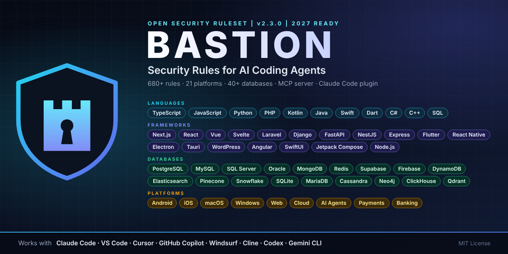

<div align="center">



# Bastion MCP Server

**692 security rules for AI coding agents, served over MCP. Read-only, offline, no telemetry.**

[](https://www.npmjs.com/package/bastion-security-mcp)
[](https://registry.modelcontextprotocol.io)
[](LICENSE)

</div>

## Install once, use in every repo

**Claude Code (all projects, user scope)**

```bash
claude mcp add --scope user bastion -- npx -y bastion-security-mcp
```

**Claude Desktop**: Settings > Developer > Edit Config, then add to `claude_desktop_config.json`:

```json
{ "mcpServers": { "bastion": { "command": "npx", "args": ["-y", "bastion-security-mcp"] } } }
```

**Cursor** (global `~/.cursor/mcp.json`):

```json
{ "mcpServers": { "bastion": { "command": "npx", "args": ["-y", "bastion-security-mcp"] } } }
```

**VS Code** (Copilot agent mode): Command Palette > `MCP: Add Server` > npm package > `bastion-security-mcp`, or add to user settings / `.vscode/mcp.json`:

```json
{ "servers": { "bastion": { "type": "stdio", "command": "npx", "args": ["-y", "bastion-security-mcp"] } } }
```

**Windsurf** (`~/.codeium/windsurf/mcp_config.json`) and **Gemini CLI** (`~/.gemini/settings.json`):

```json
{ "mcpServers": { "bastion": { "command": "npx", "args": ["-y", "bastion-security-mcp"] } } }
```

**OpenAI Codex CLI** (`~/.codex/config.toml`):

```toml
[mcp_servers.bastion]
command = "npx"
args = ["-y", "bastion-security-mcp"]
```

On Windows, if `npx` is not found by the client, use `"command": "cmd", "args": ["/c", "npx", "-y", "bastion-security-mcp"]`.

## Tools

| Tool | What it does |
|---|---|
| `bastion_detect_stack` | Reads a project folder (names and manifests only) and returns the matching platforms |
| `bastion_get_rules` | Full rules for `core`, `lite`, or any platform (nextjs, wordpress, android, financial-banking, ...) |
| `bastion_get_rule` | One rule by ID, for example `NEXT-02` |
| `bastion_search_rules` | Keyword search, for example "webhook signature" |
| `bastion_red_lines` | The 12 non-negotiable Red Lines |
| `bastion_checklist` | Release checklist per platform, or the Definition of Done |
| `bastion_review_snippet` | Fast local pattern check of code against Red Lines and key rules |
| `bastion_get_template` | Hardened configs and templates (CSP, nginx, .htaccess, wp-config, RLS, ledger SQL, CI) |
| `bastion_list_platforms` | All 21 platforms with rule counts |

## Prompts

`secure` (analyze, check, plan, fix, adapt rules), `audit`, `harden`, `review`, `threat-model`, `build`, `release`, `incident`, `fintech-audit`, `site-audit`.
In Claude Code they appear as `/mcp__bastion__secure`, `/mcp__bastion__audit`, and so on.

## Resources

`bastion://rules/core`, `bastion://rules/lite`, `bastion://rules/platform/{id}`

## Why you can trust it

Read-only, no network, no shell, no writes, no telemetry, two pinned dependencies, published with npm provenance. Details: [SECURITY-MODEL.md](SECURITY-MODEL.md).

## Development

```bash
cd mcp
npm ci
npm test               # end-to-end tests over stdio
npm run self-test      # counts and data path
npx @modelcontextprotocol/inspector node src/index.js
```

When run from the repo, the server reads the rules from the repo root. `npm pack` copies them into `mcp/data/`.

---

<div align="center"><sub><b>BASTION v2.3.0</b> | MIT License | Created by <a href="https://bizeagency.com">Muhammad Faisal</a></sub></div>
