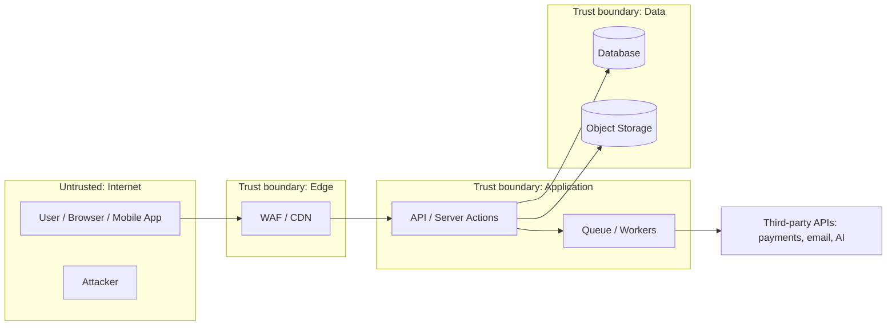

<!-- BASTION TEMPLATE | threat-model.md | v2.3.0 -->

# Threat Model: <System or Feature Name>

| Field | Value |
|---|---|
| Version | 1.0 |
| Date | YYYY-MM-DD |
| Owner | |
| Scope | |
| Data classes | Public / Internal / Confidential / Restricted |
| Bastion rules loaded | `BASTION.md`, `rules/platforms/...` |

## 1. System Overview

Short description of what the system does and who uses it.

## 2. Data-Flow Diagram

## 3. Assets

| Asset | Classification | Where stored | Owner |
|---|---|---|---|
| | | | |

## 4. Entry Points and Trust Boundaries

| Entry point | Auth required | Boundary crossed | Notes |
|---|---|---|---|
| | | | |

## 5. Threats (STRIDE + ATLAS)

| ID | Element | STRIDE | Threat | Likelihood (1-5) | Impact (1-5) | Risk | Mitigation | Bastion rule | Status |
|---|---|---|---|---|---|---|---|---|---|
| T-01 | | S | | | | | | AUTH-xx | Open |

STRIDE: **S**poofing, **T**ampering, **R**epudiation, **I**nformation disclosure, **D**enial of service, **E**levation of privilege.
For AI components, add MITRE ATLAS techniques (prompt injection, data poisoning, model extraction, tool misuse).

## 6. Abuse Cases

- As an attacker, I want to ... so that ...

## 7. Assumptions and Out of Scope

-

## 8. Residual Risk

-

<!-- BASTION TEMPLATE END -->
